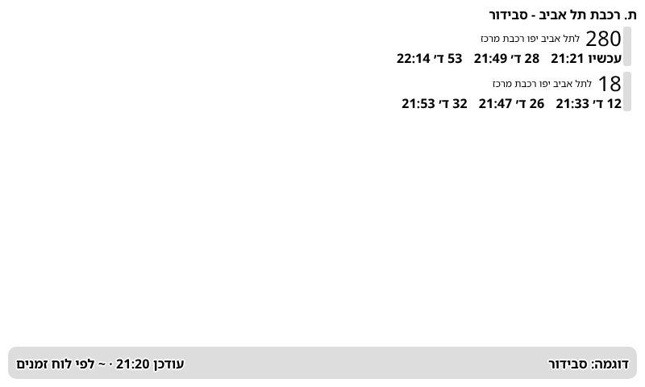
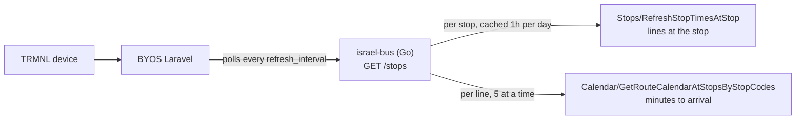

# Israel Bus - TRMNL Plugin

Upcoming bus and light rail departures for a trip (say, home to work), on a TRMNL e-ink display, in Hebrew, right to left.
No Home Assistant needed. Add one plugin instance per trip.



It is a port of the bus part of
[ziv-daniel/hass-israel-transportation-integration](https://github.com/ziv-daniel/hass-israel-transportation-integration)
(MIT): the same Ministry of Transport API (the one behind route.bus.gov.il), the same rules, without Home Assistant.



The plugin can't call the ministry API directly: listing a stop's lines needs today's date and returns about 1 MB,
and arrival times cost one request per line. The small Go service does that and returns a few hundred bytes.

## Service

```
GET /stops?stop=27997&to=21534&lines=124,155&label=&stop=21500&to=&lines=&label=
GET /healthz
```

`stop`, `to`, `lines` and `label` pair up by position and repeat, up to 4 stops. A blank `stop` is skipped.
`to` keeps only lines that reach that stop after `stop`, which picks the direction for you.
`lines` is comma-separated and matched exactly (`1` is not `1א`); blank means all lines (capped at 12).

```json
{"updated":"21:10","stops":[{"code":"27997","name":"ת. רכבת תל אביב - סבידור/הורדה","label":"","lines":[
  {"line":"253","direction":"תל אביב יפו רכבת מרכז","operator":"אלקטרה אפיקים",
   "arrivals":[{"min":5,"at":"21:12","realtime":true}]}]}]}
```

With `to`, the stop also gets `to` and `to_name`. A stop that fails gets an `error` string instead,
in Hebrew when it's a settings mistake: no line reaches `to`, or none of `lines` stops there (the error lists the ones that do). It also fails if every line lookup fails,
so an outage doesn't show up as "no buses".

Env: `LISTEN` (default `:8080`). Run locally with `go run .`; test with `go test ./...`.

## Plugin

`src/` holds `settings.yml` and the Liquid templates. Every layout prints the board built in `shared.liquid`, sized by `size`.

In BYOS Laravel, import the `israel-bus-plugin.zip` from a release (or a zip of `src/`), then set:

One instance per trip. Each trip has up to two ways to leave, e.g. a bus stop and a light rail stop.

| Field | Example |
|---|---|
| Server URL | `http://israel-bus.israel-bus.svc.cluster.local:8080` |
| Trip title | `מהבית לעבודה` |
| Option N: board at stop | `27997`, the number on the stop sign |
| Option N: get off at stop | a stop code; only lines that reach it are shown |
| Option N: lines | `124,155` (blank = all) |
| Option N: label | blank uses the stop name from the API |

Each option's header reads `from ← to`. Each arrival shows minutes until it (at poll time) and its clock time;
a `~` means a scheduled time (no live GPS for that bus).

TRMNL's fonts have no Hebrew, so the board loads Noto Sans Hebrew from Google Fonts. BYOS waits for the network
to go idle before the screenshot (`PUPPETEER_WAIT_FOR_NETWORK_IDLE`, on by default), so the font is in place.

## Release

Push a tag `israel-bus-vX.Y.Z`. CI tests, then attaches `israel-bus-linux-arm64` (static) and `israel-bus-plugin.zip` to the release.

## Not ported

Trains (rail.co.il, needs the key scraped from their site), the busnearby API (now answers 403),
and adaptive polling (BYOS polls on a fixed interval).
