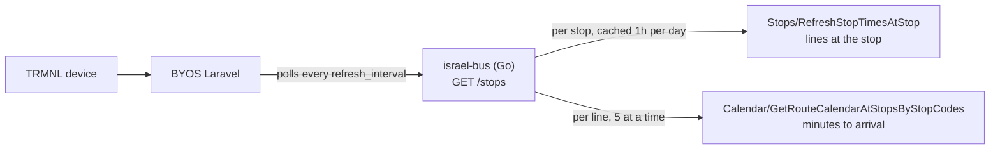

# Israel Bus - TRMNL Plugin

Upcoming bus arrivals for up to two Israeli stops, on a TRMNL e-ink display. No Home Assistant needed.


It is a port of the bus part of
[ziv-daniel/hass-israel-transportation-integration](https://github.com/ziv-daniel/hass-israel-transportation-integration)
(MIT): the same Ministry of Transport API (the one behind route.bus.gov.il), the same rules, without Home Assistant.



The plugin can't call the ministry API directly: listing a stop's lines needs today's date and returns about 1 MB,
and arrival times cost one request per line. The small Go service does that and returns a few hundred bytes.

## Service

```
GET /stops?stop=27997&lines=124,155&label=Home&stop=21500&lines=&label=Work
GET /healthz
```

`stop`, `lines` and `label` pair up by position and repeat, up to 4 stops. A blank `stop` is skipped.
`lines` is comma-separated and matched exactly (`1` is not `1א`); blank means all lines (capped at 12).

```json
{"updated":"21:10","stops":[{"code":"27997","label":"Home","lines":[
  {"line":"253","direction":"תל אביב יפו רכבת מרכז","operator":"אלקטרה אפיקים",
   "arrivals":[{"min":5,"at":"21:12","realtime":true}]}]}]}
```

A stop that fails, or asks for a line that doesn't stop there, gets an `error` string instead
(the second case lists the lines that do stop there). It also fails if every line lookup fails,
so an outage doesn't show up as "no buses".

Env: `LISTEN` (default `:8080`). Run locally with `go run .`; test with `go test ./...`.

## Plugin

`src/` holds `settings.yml` and the Liquid templates. Every layout prints the board built in `shared.liquid`, sized by `size`.

In BYOS Laravel, import the `israel-bus-plugin.zip` from a release (or a zip of `src/`), then set:

| Field | Example |
|---|---|
| Server URL | `http://israel-bus.israel-bus.svc.cluster.local:8080` |
| Stop N label | `Home` |
| Stop N code | `27997`, the number on the stop sign |
| Stop N lines | `124,155` (blank = all) |

On screen, `21:12 (5′)` is the arrival clock time and the minutes until it at poll time.
A `~` prefix means a scheduled time (the bus has no live GPS).

## Release

Push a tag `israel-bus-vX.Y.Z`. CI tests, then attaches `israel-bus-linux-arm64` (static) and `israel-bus-plugin.zip` to the release.

## Not ported

Trains (rail.co.il, needs the key scraped from their site), light rail, the busnearby API (now answers 403),
and adaptive polling (BYOS polls on a fixed interval).
