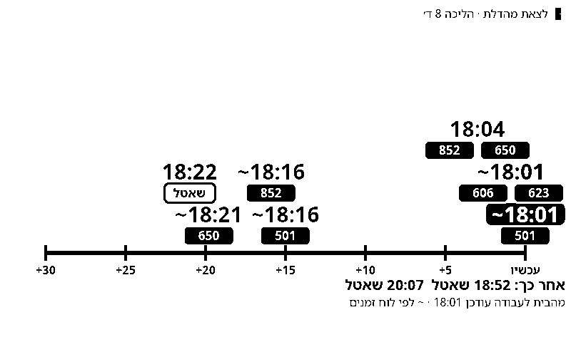
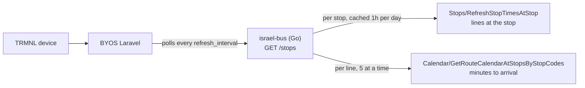

# Israel Bus - TRMNL Plugin

Upcoming bus and light rail departures for a trip (say, home to work), on a TRMNL e-ink display, in Hebrew, right to left.
No Home Assistant needed. Add one plugin instance per trip.



It is a port of the bus part of
[ziv-daniel/hass-israel-transportation-integration](https://github.com/ziv-daniel/hass-israel-transportation-integration)
(MIT): the same Ministry of Transport API (the one behind route.bus.gov.il), the same rules, without Home Assistant.



The Go service does the work: it calls the ministry API, filters by direction, and works out leave times, the ruler and the "later" line.
It sends data only (see [Service API](#service-api)); the plugin's Liquid templates draw the board.

## Service API

The service sends data only; the plugin's Liquid draws it. Two endpoints, no auth, no key:

```
GET /stops?title=מהבית+לעבודה&stop=27997&to=21534&lines=124,155&label=&walk=3&shuttle=16:30,18:00&stop=21500&...
GET /healthz        -> 200 "ok"
```

Env: `LISTEN` (default `:8080`). Run locally with `go run .`; test with `go test ./...`.

### `GET /stops` query

`stop`, `to`, `lines`, `label`, `walk` and `shuttle` repeat and **pair up by position**: the 1st of each describes option 1, the 2nd option 2, and so on.
Up to 4 options; an option with a blank `stop` and a blank `shuttle` is skipped (an unused TRMNL slot).

| Param | Meaning |
|---|---|
| `title` | Trip title, echoed back. Blank gives `אוטובוסים`. Not repeated |
| `stop` | Board at this stop: digits only (`makat`, 1-6 digits). Blank with a `shuttle` makes a shuttle-only option |
| `to` | Get off at this stop (digits). Keeps only lines that reach it *after* `stop`, which picks the direction |
| `lines` | Comma-separated line numbers, matched exactly (`1` is not `1א`). Blank = all |
| `label` | Header text. Blank uses the stop's name from the ministry API |
| `walk` | Minutes from the door to the stop, 0-60. Times come back as leave times (bus time minus walk); buses you can no longer reach are dropped |
| `shuttle` | Hand-entered departures, `HH:MM`, separated by `,` `;` or whitespace (`16:30, 18:00`). Today only, Israel time, exact. They merge with the buses as line `שאטל` |

Errors are plain-text HTTP 400: a `shuttle` time that is not `HH:MM`, `walk` outside 0-60, a non-numeric `stop` or `to`, or more than 4 options.
A stop that cannot be read is **not** an HTTP error: that stop carries an `error` string (Hebrew for settings mistakes: no line reaches `to`, or none of `lines` stops there, and the message lists the ones that do).
It also gets one when every line lookup fails, so an outage never looks like "no buses".

### `GET /stops` response

```json
{
  "title": "מהבית לעבודה",
  "updated": "17:55",
  "walks": "8",
  "stops": [{
    "code": "21669", "name": "קניון עזריאלי/דרך מנחם בגין", "label": "",
    "to": "26749", "to_name": "סינמה סיטי/כביש 2",
    "walk": 8,
    "header": "קניון עזריאלי ← סינמה סיטי",
    "lines": [{"line": "852", "direction": "פרדס חנה כרכור תחנת הרכבת", "operator": "אגד",
               "arrivals": [{"min": 0, "at": "17:56", "realtime": true}, {"min": 14, "at": "18:09", "realtime": false}]}],
    "shuttles": [{"min": 4, "at": "18:00", "realtime": true}],
    "departures": [{"line": "910", "min": 2, "at": "17:58", "realtime": true, "bus": "18:06",
                    "tier": 1, "emoji": "🚶", "pos": 0, "level": 0, "bottom": 0, "more": null}]
  }],
  "ruler": [{"line": "623", "min": 3, "at": "17:59", "realtime": true, "bus": "18:07",
             "tier": 1, "emoji": "🚶", "pos": 10, "level": 1, "bottom": 60, "more": ["501"]}],
  "later": []
}
```

**Raw data** (what the ministry API gave, per stop):

| Field | Meaning |
|---|---|
| `code`, `name`, `label` | Stop code, its Hebrew name, and the label you passed |
| `to`, `to_name` | Present with `to`: the destination stop |
| `lines[]` | Up to 6 lines at the stop, soonest first: `line`, `direction`, `operator`, and `arrivals[]` of `{min, at, realtime}` |
| `arrivals[].realtime` | `true` = live GPS; `false` = scheduled (shown with `~`) |
| `shuttles[]` | The hand-entered departures, same shape as arrivals (always `realtime: true`) |
| `walk` | The walking minutes you passed |
| `error` | Set when this stop failed, see above |

**Derived data** (what the service works out so the Liquid does not have to):

| Field | Meaning |
|---|---|
| `stops[].header` | Column title, `from ← to`, with names cut at `/` (the street part) |
| `stops[].departures[]` | Every line's arrivals plus shuttles as when to *leave the door*, soonest first, at most 9 buses (shuttles are never cut) |
| `departures[].at`, `.min` | Leave time and minutes until it: the bus's minus `walk`. `bus` is the bus's own clock time |
| `departures[].tier`, `.emoji` | Urgency: 0 🏃 now (≤1 min), 1 🚶 soon (≤5), 2 ☕ time (≤20), 3 🛋️ plenty |
| `ruler[]` | The full layout's pins: departures within the next 30 minutes across *all* stops, at most 10 |
| `ruler[].pos`, `.level`, `.bottom` | Place on the axis: `pos` is 0-100 (percent from "now"); `level` the row, 0 at the axis; `bottom` that row's height in px. Only meaningful in `ruler` |
| `ruler[].more` | Other lines leaving the same minute, merged into this pin (`null` when none) |
| `later[]` | What the ruler did not place: every shuttle (up to 3), then the next buses, 4 in all |
| `walks` | Walking minutes for the ruler header: `"3"`, `"3 / 5"`, or `""` |

No stops configured gives `"stops": []` (not `null`), which the template reads as "set a stop in the plugin settings".

### Upstream

The service reads the Ministry of Transport API behind route.bus.gov.il (anonymous, no key):
`Stops/RefreshStopTimesAtStop` lists the lines at a stop (about 1 MB; needs today's date; cached 1 h per stop and day) and
`Calendar/GetRouteCalendarAtStopsByStopCodes` gives minutes to arrival, one request per line, 5 at a time.
A poll has a 9 s budget, because BYOS Laravel gives a poll 10 s.

## Plugin

`src/` holds `settings.yml` and the Liquid templates, which draw the board from the service's data
(or "server unreachable" if the poll failed). The board is Hebrew, right to left; [`src/shared.liquid`](src/shared.liquid) holds its CSS and markup.
One payload serves every size: BYOS wraps each layout in `.view--{size}`, and CSS there stacks, trims or hides
(full: the ruler; halves and quadrant: 3 rows per stop; quadrant: option 1 only).

In BYOS Laravel, import the `israel-bus-plugin.zip` from a release (or a zip of `src/`), then set:

One instance per trip. Each trip has up to two ways to leave, e.g. a bus stop and a light rail stop.

| Field | Example |
|---|---|
| Server URL | `http://israel-bus.israel-bus.svc.cluster.local:8080` |
| Trip title | `מהבית לעבודה` |
| Option N: board at stop | `27997`, the number on the stop sign |
| Option N: get off at stop | a stop code; only lines that reach it are shown |
| Option N: lines | `124,155` (blank = all) |
| Option N: walk to the stop (minutes) | `3`; blank or 0 shows plain bus times |
| Option N: shuttle times | `16:30, 18:00, 20:00`, merged with the buses; blank stop = shuttles only |
| Option N: label | blank uses the stop name from the API |

Each option's header reads `from ← to`. The board shows when to **leave the door**, not when the bus comes: each option has a walking time, and every time shown
is the bus time minus it (buses you can no longer reach on foot are hidden). Refreshes are infrequent, so clock times stay
true longer than "in 5 min".
The full layout is one ruler: the next 30 minutes of leave times, now at the right, as big times with the line in a badge below
(the next one is a black block). Buses leaving the same minute share one pin with several badges. Anything past 30 minutes, or past 10 pins, goes in an "אחר כך" line.
The smaller layouts are rows per stop: an emoji for urgency (🏃 now, 🚶 soon, ☕ time, 🛋️ plenty), the leave time, the line, the bus's own time (🚌, hidden when there is no walk) and the minutes until leaving;
shuttles get an outlined badge. Urgency is also a color (red, orange, green, blue) for color screens such as Android tablets;
the colors are dark so they stay readable in grayscale on e-ink;
a `~` means a scheduled time (no live GPS for that bus).

TRMNL's fonts have no Hebrew, so the board loads Noto Sans Hebrew from Google Fonts, plus Noto Color Emoji for the urgency emoji (BYOS's Alpine Chromium may have no emoji font). BYOS waits for the network
to go idle before the screenshot (`PUPPETEER_WAIT_FOR_NETWORK_IDLE`, on by default), so the font is in place.

## Release

Push a tag `israel-bus-vX.Y.Z`. CI tests, then attaches `israel-bus-linux-arm64` (static) and `israel-bus-plugin.zip` to the release.

## Not ported

Trains (rail.co.il, needs the key scraped from their site), the busnearby API (now answers 403),
and adaptive polling (BYOS polls on a fixed interval).
